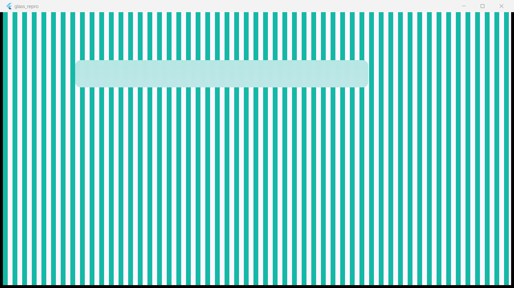
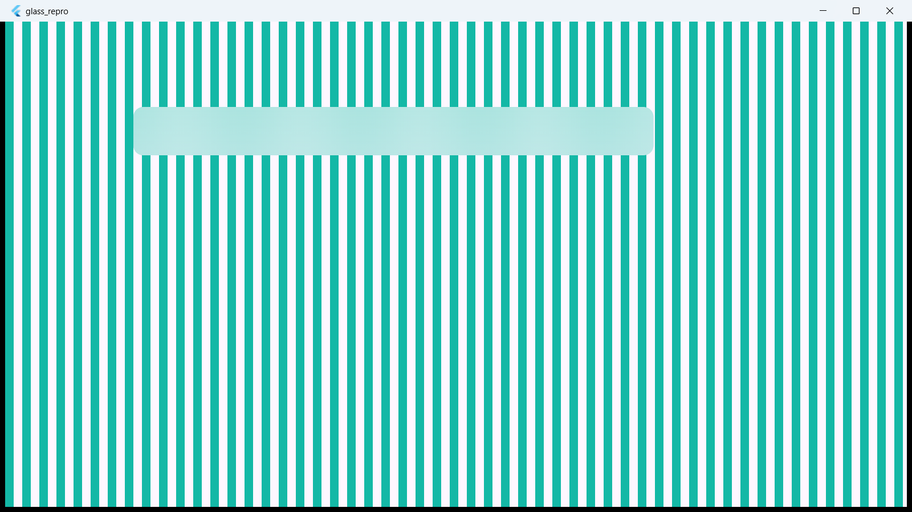

# Flutter Windows: BackdropFilter content truncated at fractional display scale

Minimal reproduction for a Flutter Windows rendering issue where the content of a
`BackdropFilter` (glass-morphism) subtree is composited at ~79% of its layout height
under a **fractional display scale (125%)**, leaving the bottom ~21% of the widget
never painted. The paint stops along a hard horizontal edge, which reads as a
"line" across the glass surface; any text inside the subtree is sliced at that edge.

## Repro

1. Windows 11, display scale **125%**.
2. `flutter create` a new Windows app (or clone this repo) and replace `lib/main.dart`
   with [`lib/main.dart`](lib/main.dart): a striped `CustomPaint` background plus one
   `ClipRRect > BackdropFilter(ImageFilter.blur) > gradient DecoratedBox` card.
3. `flutter run -d windows`.

### Broken (3.47.7-candidate.0, engine deb287481e)

The glass card's fill and blur stop at ~80% of the card height; the bottom of the
card shows the raw background. The stripes painted by the surrounding `CustomPaint`
also render with logical spacing used as device pixels (24 device-px period instead
of 30), i.e. the page content is rasterized as if `devicePixelRatio` were 1.0.

### Correct (stable 3.44.4, engine a10d8ac38d)

Same code, same machine, same 125% scale: full-height glass, correct 30 device-px
stripe period.

At 100% display scale both versions render correctly.

## Measurements (pixel scans)

Layout: glass card 68 logical px tall (85 device px at 125%).

| Flutter version | scale | painted card height (device px) | truncated |
|---|---|---|---|
| 3.47.7-candidate.0 | 125% | ~67 (fill stops ~21 device px early) | yes |
| 3.47.7-candidate.0 | 100% | 68 (full) | no |
| 3.44.4 stable | 125% | 85 (full) | no |

Also observed in a real app on 3.47.7-candidate.0 at 125%: six glass widgets of
heights 40/50/60/68/80/100 logical all painted exactly ~0.79x of their layout
height, and text inside them was sliced at the same edge.

## Notes

- Reproduces with both `BackdropFilter(filter: ImageFilter.blur(...))` and the newer
  `BackdropFilter(filterConfig: ImageFilterConfig.blur(..., bounded: true))`.
- Reproduces with both Impeller (default) and Skia (`--no-enable-impeller`).
- Not reproducible in `flutter_test` (software renderer).
- Excluded as triggers: `ClipRRect`/clip behavior, `RepaintBoundary`, `AnimatedScale`,
  `Material` type, page-transition wrappers, scroll implementation.
